<div align="center">


<a href="#-models">
  
</a>

<br/>


</div>

---

## 🧭 Contents

| | Model | Family | Folder |
|:-:|---|---|---|
| 📉 | [ARIMA & SARIMA](#-arima--sarima) | Classical statistics | [`forecasting/ARIMA SARIMA`](forecasting/ARIMA%20SARIMA) |
| 🌲 | [XGBoost](#-xgboost) | Gradient-boosted trees | [`forecasting/XGboost`](forecasting/XGboost) |
| 🧠 | [LSTM](#-lstm) | Recurrent neural network | [`forecasting/LSTM`](forecasting/LSTM) |
| 🔮 | [Prophet](#-prophet) | Additive decomposition | [`forecasting/prophet`](forecasting/prophet) |
| ⚡ | [Hybrid smart system](#-hybrid-smart-forecasting-system) | Ensemble / stacking | — |

### 🏁 Scoreboard at a glance

<div align="center">

| Model | Dataset | Target | Evaluation | RMSE | MAE | R² |
|---|---|---|---|:-:|:-:|:-:|
| [**ARIMA (1,0,0)**](#-arima--sarima) | BOAs (grid balancing) | daily mean level | last 7 days | — | — | **0.197** |
| [**SARIMA (1,0,0)(0,0,0,7)**](#-arima--sarima) | BOAs (grid balancing) | daily mean level | last 7 days | — | — | **0.135** |
| [**XGBoost (tuned)**](#-xgboost) | BOAs (grid balancing) | power change | test set (15%) | **3.156** | — | **0.446** |
| [**LSTM — app openings**](#-lstm) | 20-day app log | daily opens | last 3 days | **1.16** | **1.04** | −5.10 |
| [**LSTM — next word**](#-lstm) | text corpus | next token | training data | **0.0275** | — | **0.854** |
| [**Prophet**](#-prophet) | mixed web metrics | daily `y` | last 30 days | **40.33** | **31.88** | 0.061 |

<sub>Scores come from the notebook outputs. Prophet's script prints no metric, so its row is a 30-day holdout run on the same settings (MAPE 3.13%).</sub>

</div>

---

<a id="-arima--sarima"></a>
## [📉 ARIMA & SARIMA](forecasting/ARIMA%20SARIMA)

<div align="center">
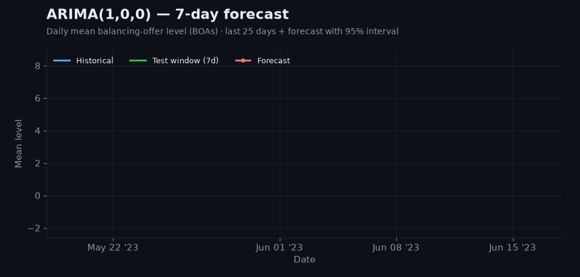
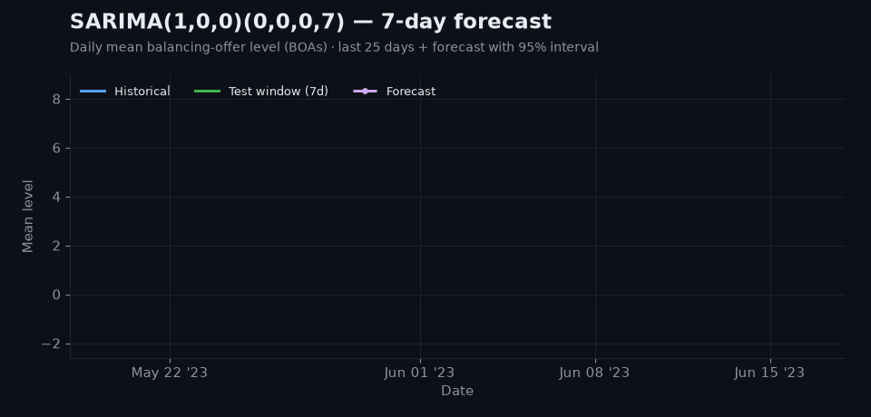
</div>

> **Why it's used —** ARIMA models a series from its own past values (AR), its past errors (MA) and differencing (I) to remove trend. It is fast, explainable and gives honest confidence intervals, which makes it the standard baseline every other model has to beat. **SARIMA** adds a seasonal block `(P,D,Q,s)` so repeating weekly or yearly cycles are captured directly.

**What the notebook does**
- Averages `levelFrom` / `levelTo` of Balancing Offer Acceptances (BOAs) into a daily signal and fills gaps by linear interpolation.
- Brute-force grid search over `(p,d,q)` (and seasonal `(P,D,Q,7)` for SARIMA), picking the order with the best R² on the last 7 days.
- Plots ACF / PACF for SARIMA, then refits on all data and forecasts 7 days ahead.

<table align="center">
<tr><th>Model</th><th>Best order</th><th>R² (last 7 days)</th><th>Day+1 forecast</th><th>Day+7 forecast</th></tr>
<tr><td>ARIMA</td><td><code>(1, 0, 0)</code></td><td></td><td>1.900</td><td>1.110</td></tr>
<tr><td>SARIMA</td><td><code>(1, 0, 0)(0, 0, 0, 7)</code></td><td></td><td>1.839</td><td>0.803</td></tr>
</table>

<details>
<summary>📷 Original notebook charts</summary>

| ARIMA forecast | SARIMA forecast |
|:-:|:-:|
| 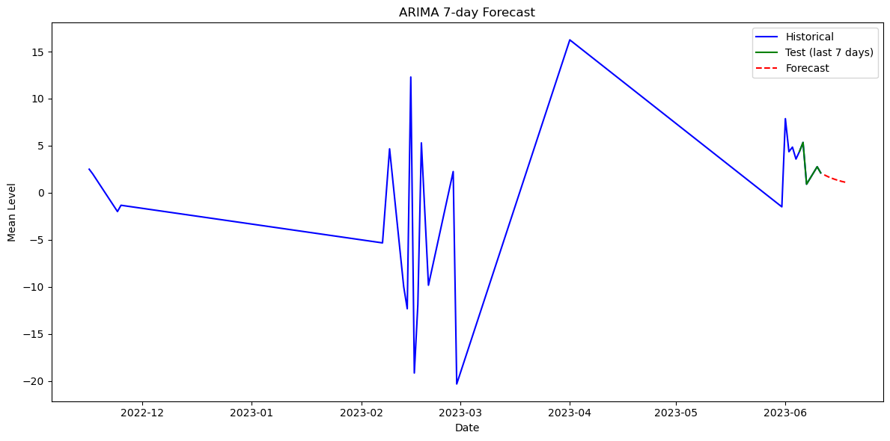 | 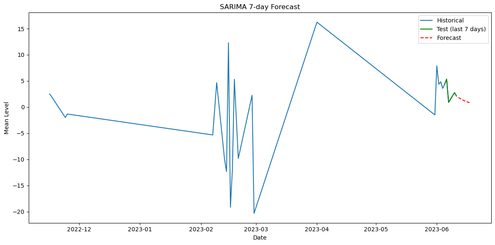 |
| **ACF** | **PACF** |
| 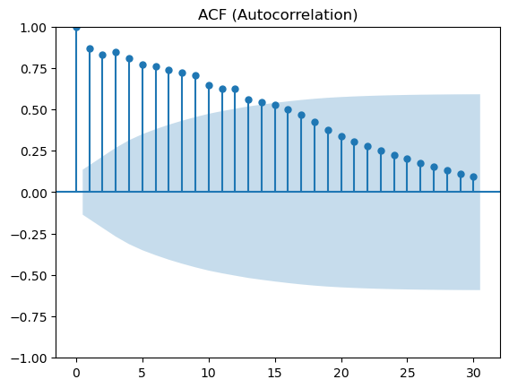 | 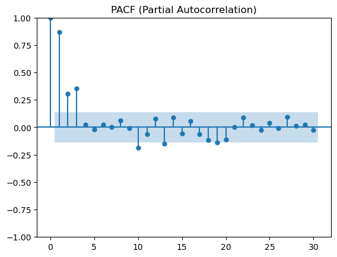 |

</details>

📂 Files: [`arimasarima (1).ipynb`](forecasting/ARIMA%20SARIMA/arimasarima%20(1).ipynb) · [`BOAs.csv`](forecasting/ARIMA%20SARIMA/BOAs.csv) · [`arimasarima (1).pdf`](forecasting/ARIMA%20SARIMA/arimasarima%20(1).pdf) · [`ESO_LSTM_BASED.pdf`](forecasting/ARIMA%20SARIMA/ESO_LSTM_BASED.pdf)

---

<a id="-xgboost"></a>
## [🌲 XGBoost](forecasting/XGboost)

<div align="center">
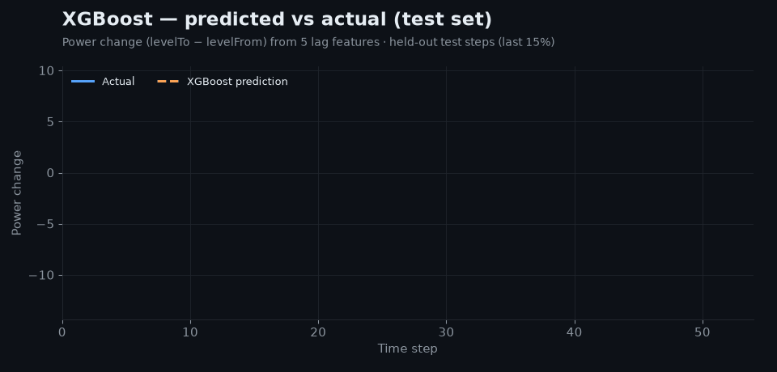
</div>

> **Why it's used —** XGBoost turns forecasting into supervised learning: past values become *lag features* and an ensemble of gradient-boosted trees learns the non-linear mapping to the next value. It handles spikes, interactions and extra features (calendar, weather, prices) that linear models miss, trains in seconds, and is regularised against over-fitting.

**What the notebook does**
- Target is `powerChange = levelTo − levelFrom` on the BOAs data, indexed by `timeFrom`.
- Builds lags `t-1 … t-5`, then a chronological split: 15% test, and 10% of the rest for validation.
- Tuned model: `n_estimators=300, learning_rate=0.03, max_depth=4, subsample=0.8, colsample_bytree=0.8, reg_alpha=0.5`.
- Recursive 20-step forecast that feeds each prediction back in as the newest lag.

<table align="center">
<tr><th>Run</th><th>Split</th><th>RMSE</th><th>R²</th></tr>
<tr><td>Baseline</td><td>Test</td><td>3.265</td><td></td></tr>
<tr><td rowspan="2"><b>Tuned (final)</b></td><td>Validation</td><td>6.680</td><td></td></tr>
<tr><td>Test</td><td><b>3.156</b></td><td></td></tr>
</table>

<details>
<summary>📷 Original notebook charts</summary>

| Test set: predicted vs actual | Next 25 steps (5 known + 20 forecast) |
|:-:|:-:|
| 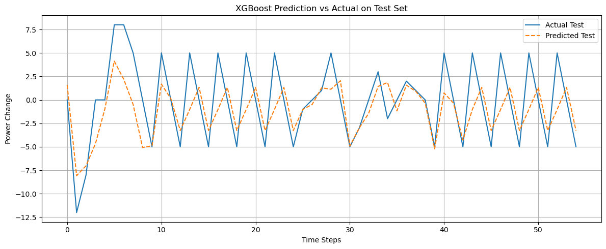 | 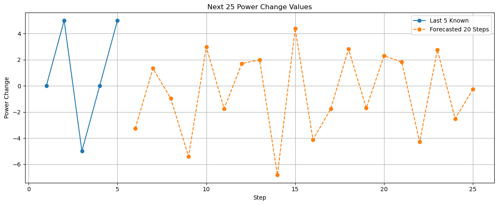 |
| **Baseline: test set** | **Baseline: next 25 steps** |
| 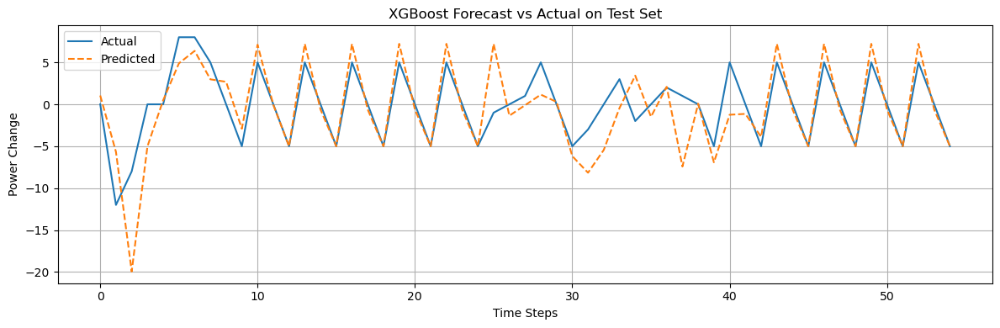 | 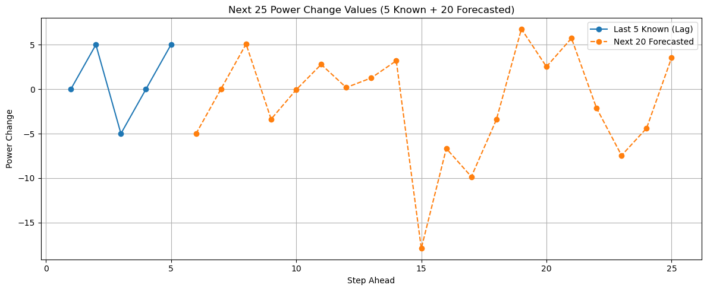 |

</details>

📂 Files: [`xgb_final_model_pr.ipynb`](forecasting/XGboost/xgb_final_model_pr.ipynb) · [`BOAs.csv`](forecasting/XGboost/BOAs.csv) · [`xgb_final_model_pr.pdf`](forecasting/XGboost/xgb_final_model_pr.pdf)

---

<a id="-lstm"></a>
## [🧠 LSTM](forecasting/LSTM)

<div align="center">
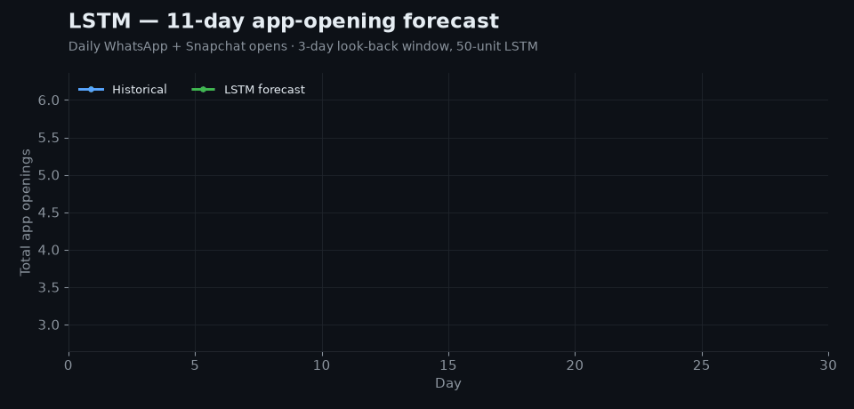
</div>

> **Why it's used —** A Long Short-Term Memory network is a recurrent neural net with gates that decide what to remember and what to forget. That lets it learn long-range, non-linear patterns in sequences without hand-built features. The same idea powers both **numeric forecasting** (what happens tomorrow?) and **sequence modelling of text** (what's the next word?), and this folder shows both.

**What the notebooks do**
- **`appopening.ipynb`**: sums WhatsApp + Snapchat opens per day, scales them to `[0, 1]`, uses a 3-day look-back window and a 50-unit ReLU LSTM, trains for 100 epochs, then forecasts 11 days recursively.
- **`lstmpredict.ipynb`**: tokenises a text corpus and trains `Embedding(100) → LSTM(150) → softmax` for next-word prediction, with top-3 suggestions (e.g. *"bhangra brought" → **new***).

<table align="center">
<tr><th>Notebook</th><th>Task</th><th>Metrics</th></tr>
<tr><td><code>appopening</code></td><td>Daily app-opening forecast</td><td>RMSE <b>1.16</b> · MAE <b>1.04</b> · R² −5.10 <sub>(3-point test set)</sub></td></tr>
<tr><td><code>lstmpredict</code></td><td>Next-word prediction</td><td> loss 0.244 · RMSE 0.0275 · RAE 0.185 · R² <b>0.854</b> <sub>(training data)</sub></td></tr>
</table>

<sub>⚠️ The app-opening dataset is only 20 days long and the test set has 3 points, so its R² is not meaningful. The LSTM needs a longer history to beat a naive baseline.</sub>

<details>
<summary>📷 Original notebook charts</summary>

| Actual vs predicted (test) | Historical + 11-day forecast |
|:-:|:-:|
| 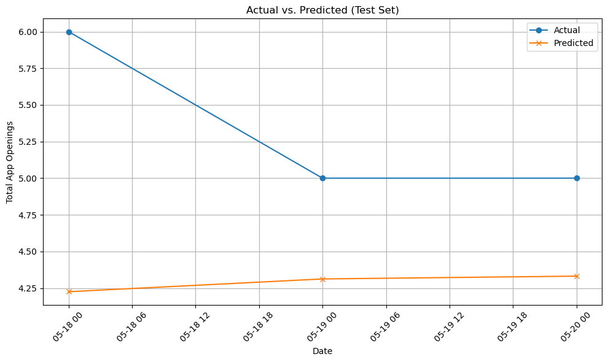 | 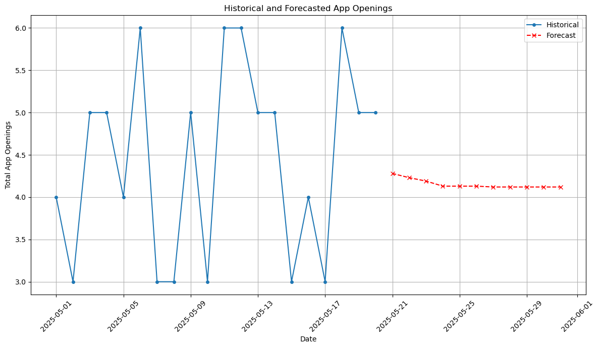 |

</details>

📂 Files: [`appopening.ipynb`](forecasting/LSTM/appopening.ipynb) · [`lstmpredict.ipynb`](forecasting/LSTM/lstmpredict.ipynb) · [`app_20days.csv`](forecasting/LSTM/app_20days.csv) · [`appopening.pdf`](forecasting/LSTM/appopening.pdf) · [`lstmpredict.pdf`](forecasting/LSTM/lstmpredict.pdf)

---

<a id="-prophet"></a>
## [🔮 Prophet](forecasting/prophet)

<div align="center">
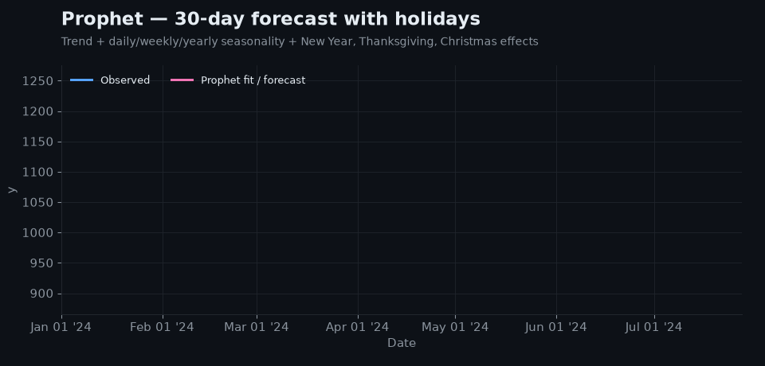
</div>

> **Why it's used —** Prophet (by Meta) breaks a series into **trend + seasonality + holidays** and fits each part separately. It copes with messy business data that has missing days, outliers and shifting trends, needs almost no tuning, and every component can be plotted and explained to non-specialists.

**What the script does**
- Cleans a deliberately *messy* dataset: coerces bad dates, interpolates missing `y`, and averages duplicate timestamps.
- Adds three tuned US holidays (New Year's Day, Thanksgiving and Christmas, the last two with a one-day lead-in window).
- Turns on daily, weekly and yearly seasonality and forecasts 30 days with uncertainty bands, plus Matplotlib and Plotly component plots.

<table align="center">
<tr><th>Evaluation</th><th>MAE</th><th>RMSE</th><th>MAPE</th><th>R²</th></tr>
<tr><td>30-day holdout</td><td>31.88</td><td>40.33</td><td></td><td>0.061</td></tr>
</table>

<sub>A 3% average error on a series that hovers around 1,000. The low R² shows that most of the 30-day variation is day-to-day noise rather than predictable signal.</sub>

```bash
pip install prophet holidays plotly
python forecasting/prophet/prophet.py
```

📂 Files: [`prophet.py`](forecasting/prophet/prophet.py) · [`messy_mixed_timeseries_data.csv`](forecasting/prophet/messy_mixed_timeseries_data.csv)

---

<a id="-hybrid-smart-forecasting-system"></a>
## [⚡ Hybrid smart forecasting system](#-hybrid-smart-forecasting-system)

<div align="center">
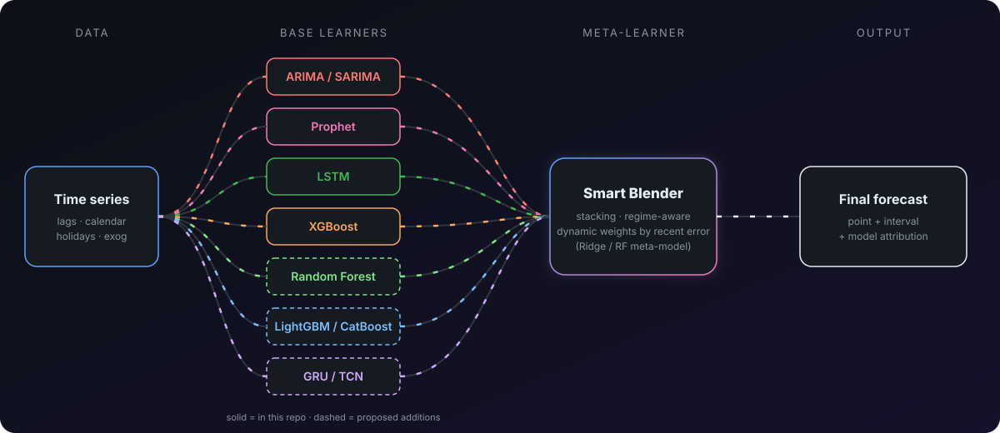
</div>

Every model here sees the data differently, and **that difference is what a hybrid system uses**. No single model wins on every horizon or every regime. A smart system runs them side by side and learns *when to trust which*.

| Layer | Models | What it brings |
|---|---|---|
| **Statistical core** | ARIMA, SARIMA | Stable trend and seasonality, calibrated intervals, a strong short-horizon baseline |
| **Decomposition** | Prophet | Holiday and event effects, changepoints, explainable components |
| **Tree ensembles** | XGBoost, **Random Forest**, LightGBM, CatBoost | Non-linear effects of lags and external features; Random Forest adds low-variance bagged predictions |
| **Deep sequence** | LSTM, GRU, TCN / Transformer | Long-range, multivariate patterns |
| **Meta-learner** | Ridge or Random Forest stacker | Learns the best weights from each model's out-of-fold forecasts |

**How it becomes "smart"**
1. **Residual hybrid.** ARIMA/Prophet captures the linear trend and seasonality, then XGBoost or Random Forest models the *residuals* that are left over.
2. **Stacking.** Each base model produces out-of-fold forecasts with time-series cross-validation, and a meta-model combines them.
3. **Dynamic weighting.** Weights are updated from each model's rolling recent error (for example inverse-RMSE), so the system shifts automatically when the regime changes.
4. **Uncertainty fusion.** The interval comes from statistical confidence bands combined with quantile or conformal bounds on the ensemble.

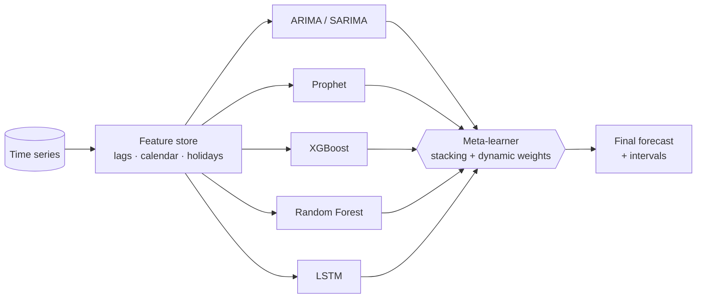

---

<div align="center">

### 👤 Author

**piscongentine**

[](https://github.com/piscongentine)

<sub>If this repo helped you, leave a ⭐</sub>


</div>
